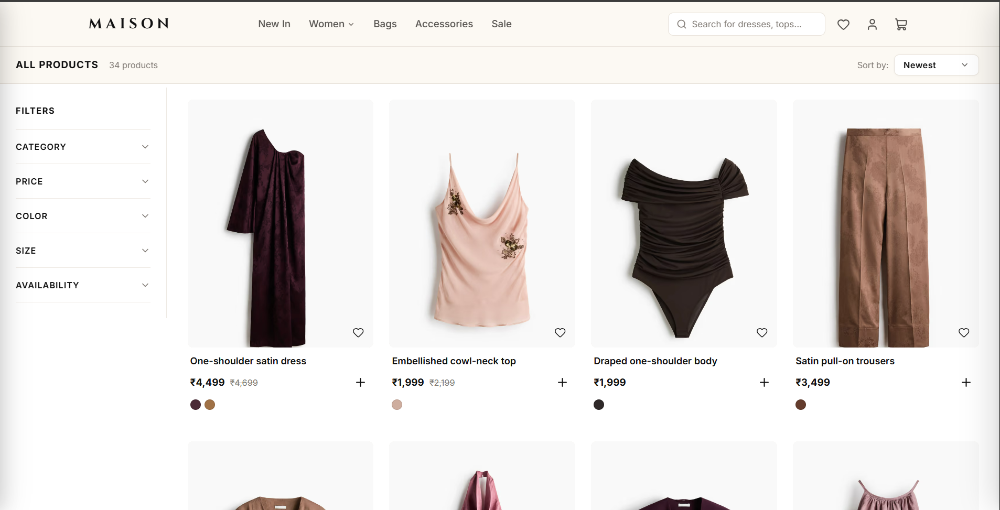
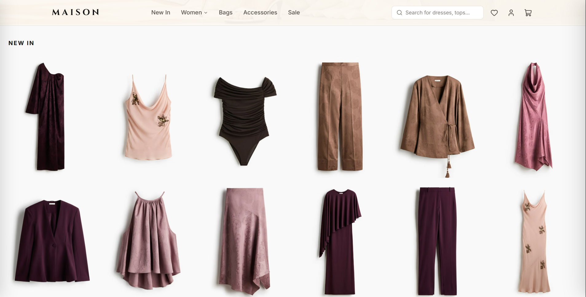
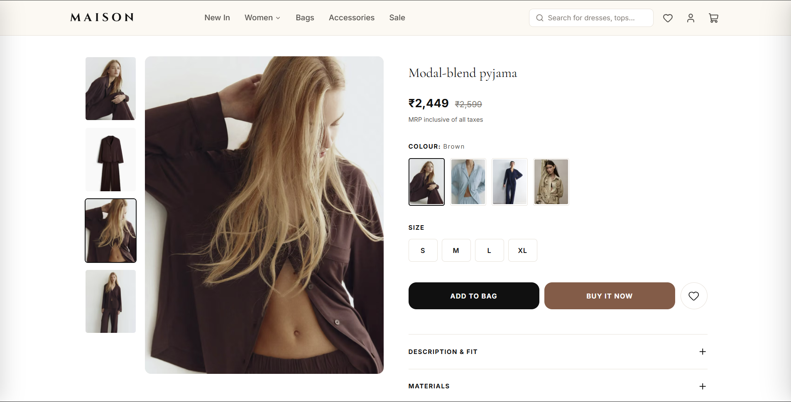
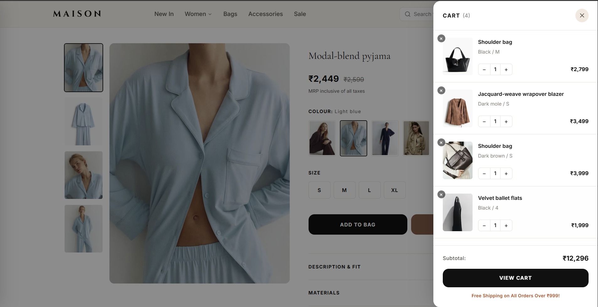
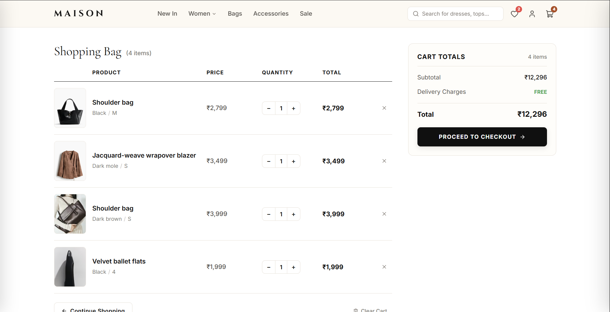
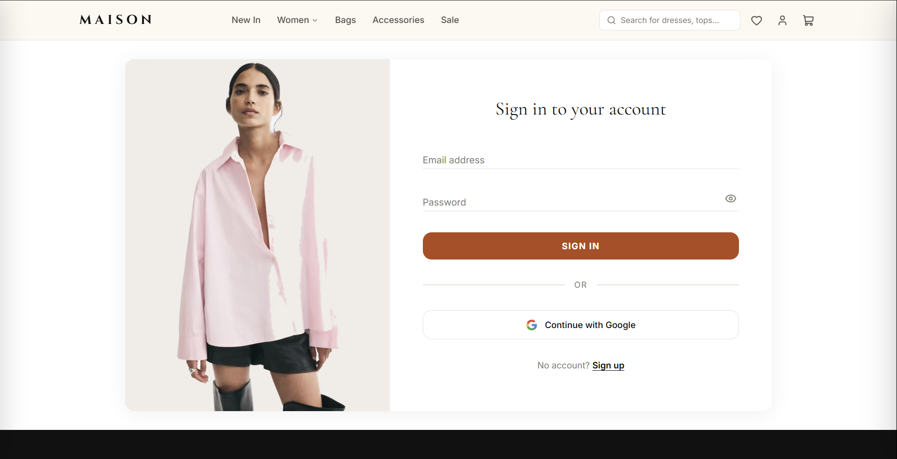
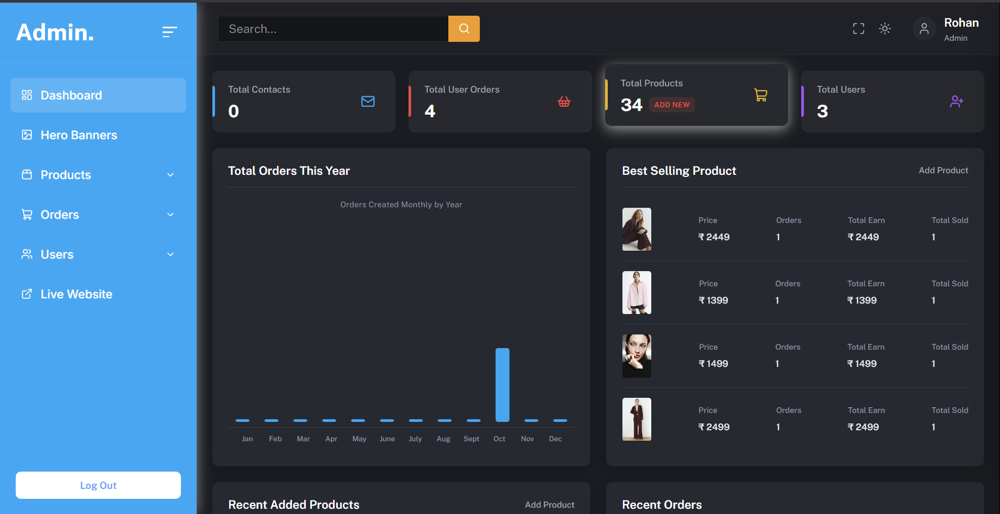
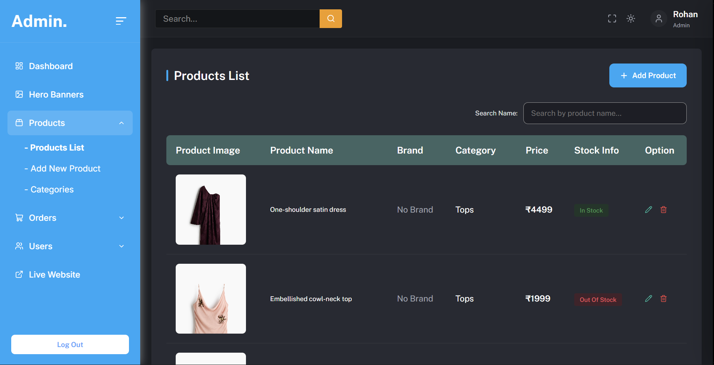

# Maison Atelier

A full-stack, enterprise-grade luxury fashion e-commerce platform built with Next.js 16 (App Router), React 19, Node.js, Express, and MongoDB. The system features a high-performance storefront, a comprehensive administrative management dashboard, role-based access control, cryptographic payment verification via Razorpay, cloud asset storage via ImageKit, and Google OAuth 2.0 authentication.

**Live Demo**: [maison.tabrezrabbani.in](https://maison.tabrezrabbani.in) | **API Base**: [api-maison.tabrezrabbani.in](https://api-maison.tabrezrabbani.in)

---

## Table of Contents

- [Overview](#overview)
- [Screenshots](#screenshots)
  - [Storefront Views](#storefront-views)
  - [Administrative Dashboard](#administrative-dashboard)
- [System Architecture](#system-architecture)
- [Tech Stack](#tech-stack)
- [Repository Structure](#repository-structure)
- [Key Features](#key-features)
  - [Storefront Features](#storefront-features)
  - [Administrative Operations](#administrative-operations)
  - [Security and Resilience](#security-and-resilience)
- [Getting Started](#getting-started)
  - [Prerequisites](#prerequisites)
  - [Backend Setup](#backend-setup)
  - [Frontend Setup](#frontend-setup)
- [Environment Variables](#environment-variables)
  - [Backend Configuration](#backend-configuration)
  - [Frontend Configuration](#frontend-configuration)
- [API Reference](#api-reference)
- [Production Deployment](#production-deployment)
- [License](#license)

---

## Overview

Maison Atelier is designed with a modern decoupled architecture. The repository is organized as a monorepo containing both the backend REST API service and the frontend client application.

- **Storefront / Client Application**: Hosted on [maison.tabrezrabbani.in](https://maison.tabrezrabbani.in)
- **Backend API Service**: Hosted on [api-maison.tabrezrabbani.in](https://api-maison.tabrezrabbani.in)

Both services share the primary domain namespace, allowing seamless cross-origin communication, HTTP-only cookie-based authentication, and localized session persistence.

---

## Screenshots

### Storefront Views

#### Homepage Showcase


#### Catalog and New Arrivals
| Collection View | New In Showcase |
| :---: | :---: |
|  |  |

#### Product Experience and Shopping Bag
| Product Detail Page | Slide-out Cart Drawer |
| :---: | :---: |
|  |  |

#### Bag Summary and Authentication
| Dedicated Bag View | Sign In and Authentication |
| :---: | :---: |
|  |  |

### Administrative Dashboard

#### Analytics and Performance Overview


#### Inventory and Product Management


---

## System Architecture

```
                    +------------------------------------+
                    |        Client Web Browser          |
                    |    (maison.tabrezrabbani.in)       |
                    +-----------------+------------------+
                                      |
                     HTTPS Requests / Credentials (Cookies)
                                      |
                                      v
                    +-----------------+------------------+
                    |        Next.js 16 Frontend         |
                    |     (App Router, Turbopack)        |
                    +-----------------+------------------+
                                      |
                       API Calls (Axios Instance)
                                      |
                                      v
                    +-----------------+------------------+
                    |        Express Backend API         |
                    |      (api-maison.tabrezrabbani.in)        |
                    +----+------------+------------+-----+
                         |            |            |
                         v            v            v
                 +-------+--+   +-----+----+   +---+--------+
                 | MongoDB  |   | ImageKit |   |  Razorpay  |
                 | Database |   | Storage  |   |  Payments  |
                 +----------+   +----------+   +------------+
```

---

## Tech Stack

### Frontend
- **Framework**: Next.js 16 (App Router)
- **Library**: React 19
- **Language**: TypeScript
- **Styling**: Vanilla CSS Modules (Zero runtime CSS overhead)
- **State Management**: React Context API
- **Icons & UI Utilities**: Lucide React, Sonner (Notifications)
- **HTTP Client**: Axios with automatic interceptors and token refresh
- **Bundler & Build Tool**: Turbopack

### Backend
- **Runtime**: Node.js (ES Modules)
- **Framework**: Express 5
- **Database**: MongoDB via Mongoose ODM
- **Architecture Pattern**: Layered DAO (Data Access Object) Pattern
- **Authentication**: JWT (Access Token in HTTP-only cookie, Refresh Token rotation)
- **OAuth**: Passport.js with Google OAuth 2.0 Strategy
- **Media Management**: ImageKit Node.js SDK with Multer memory storage
- **Payments**: Razorpay Node.js SDK with SHA-256 HMAC cryptographic signature verification
- **Security & Headers**: Helmet, Express Rate Limit, Cookie Parser, Morgan

---

## Repository Structure

```
project-atelier/
├── backend/
│   ├── src/
│   │   ├── config/             # Environment and database connections
│   │   ├── controllers/        # Request handling and HTTP responses
│   │   ├── dao/                # Data Access Object abstraction layer
│   │   ├── middlewares/        # Auth, role guard, error handling, rate limiters
│   │   ├── models/             # Mongoose schemas and compound indexes
│   │   ├── routes/             # REST route definitions
│   │   ├── services/           # Core business logic and external integrations
│   │   ├── utils/              # Custom AppError and helper utilities
│   │   └── validators/         # Express-validator validation chains
│   ├── .env.example            # Backend environment template
│   ├── package.json
│   └── server.js               # Application bootstrap and server entry point
├── frontend/
│   ├── public/                 # Static assets, logos, and favicons
│   ├── src/
│   │   ├── app/                # Next.js App Router (pages and layouts)
│   │   │   ├── (storefront)/   # Home, collection, product, cart, checkout, account
│   │   │   └── admin/          # Admin dashboard, products, orders, users, banners
│   │   ├── components/         # Reusable UI components, guards, headers, footers
│   │   ├── context/            # AuthContext, CartContext, WishlistContext
│   │   ├── hooks/              # Custom React hooks
│   │   ├── lib/                # Axios instance, animation definitions, utilities
│   │   └── types/              # TypeScript interfaces and type definitions
│   ├── .env.example            # Frontend environment template
│   ├── next.config.ts          # Image optimization and compiler options
│   ├── package.json
│   └── tsconfig.json
├── .gitignore                  # Monorepo root ignore rules
└── README.md                   # Project documentation
```

---

## Key Features

### Storefront Features
- **Responsive Layout**: Designed for mobile, tablet, and ultra-wide screens.
- **Dynamic Catalog**: Category browsing, brand filtering, sorting by price and date, and instant search.
- **Product Experience**: Multi-image galleries, sizing guides, stock status indicators, and related product recommendations.
- **Shopping Cart**: Real-time stock reservation, quantity adjustments, persistent local/server synchronization.
- **Wishlist**: Quick add/remove with cross-device synchronization for authenticated buyers.
- **Seamless Checkout**: Address management, Cash on Delivery, and Razorpay online payments with signature verification.
- **Customer Account**: Profile management, order history tracking, delivery status updates, and cancellation requests.

### Administrative Operations
- **Analytics Overview**: Live revenue metrics, monthly growth, order distribution charts, and low-stock alerts.
- **Product Management**: Full CRUD operations, multi-image upload via ImageKit, color and size variants, pricing, and category assignment.
- **Category Management**: Category hierarchy creation, slug generation, and cover image configuration.
- **Order Management**: Order lifecycle tracking (Pending, Processing, Shipped, Delivered, Cancelled), cancellation review, and shipping address auditing.
- **Hero & Banner Management**: Dynamic homepage hero carousel configuration, badge labels, and promotional linking.
- **User Directory**: Customer and administrative user listing with role inspection.
- **Security Guard**: `AdminGuard` component protecting all administrative routes, strictly verifying `admin` role with automatic redirection for unauthenticated access.

### Security and Resilience
- **HTTP-Only Cookies**: JWT tokens are isolated from client-side JavaScript, preventing Cross-Site Scripting (XSS) extraction.
- **Rate Limiting**: Tiered limiters preventing brute-force attacks on login/registration routes and abuse on general API endpoints.
- **Reverse Proxy Support**: Configured with `trust proxy` enabled for accurate IP logging and rate limiting behind cloud load balancers.
- **Input Validation**: Sanitization and validation on all mutation endpoints using `express-validator`.
- **Centralized Error Handling**: Unified error middleware preventing server stack trace leaks in production environments.

---

## Getting Started

### Prerequisites
- Node.js (v18.18.0 or later recommended)
- npm or yarn
- MongoDB Atlas cluster or local MongoDB instance (v6.0+)
- ImageKit account (for media storage)
- Razorpay account (for payment processing)
- Google Cloud Console OAuth 2.0 credentials

---

### Backend Setup

1. Navigate to the backend directory:
   ```bash
   cd backend
   ```

2. Install dependencies:
   ```bash
   npm install
   ```

3. Create the environment file:
   ```bash
   cp .env.example .env
   ```

4. Populate `.env` with your credentials:
   ```env
   PORT=5000
   NODE_ENV=development
   MONGO_URI=mongodb+srv://<username>:<password>@cluster0.mongodb.net/project-atelier?retryWrites=true&w=majority
   JWT_ACCESS_SECRET=your_jwt_access_secret
   JWT_ACCESS_EXPIRE=15m
   JWT_REFRESH_SECRET=your_jwt_refresh_secret
   JWT_REFRESH_EXPIRE=7d
   GOOGLE_CLIENT_ID=your_google_client_id.apps.googleusercontent.com
   GOOGLE_CLIENT_SECRET=your_google_client_secret
   IMAGEKIT_PRIVATE_KEY=your_imagekit_private_key
   RAZORPAY_KEY_ID=your_razorpay_key_id
   RAZORPAY_KEY_SECRET=your_razorpay_key_secret
   RAZORPAY_WEBHOOK_SECRET=your_razorpay_webhook_secret
   CLIENT_URL=http://localhost:3000
   ```

5. Start the backend development server:
   ```bash
   npm run dev
   ```
   The backend will be available at `http://localhost:5000`.

---

### Frontend Setup

1. Navigate to the frontend directory:
   ```bash
   cd frontend
   ```

2. Install dependencies:
   ```bash
   npm install
   ```

3. Create the environment file:
   ```bash
   cp .env.example .env.local
   ```

4. Populate `.env.local`:
   ```env
   NEXT_PUBLIC_API_URL=http://localhost:5000/api
   ```

5. Start the frontend development server:
   ```bash
   npm run dev
   ```
   The application will be accessible at `http://localhost:3000`.

---

## Environment Variables

### Backend Configuration

| Variable | Description | Example / Default |
| :--- | :--- | :--- |
| `PORT` | Port number for the Express server | `5000` |
| `NODE_ENV` | Environment mode (`development` or `production`) | `production` |
| `MONGO_URI` | MongoDB connection URI string | `mongodb+srv://...` |
| `JWT_ACCESS_SECRET` | Secret key for signing access tokens | Strong 64-character random string |
| `JWT_ACCESS_EXPIRE` | Lifetime duration of access tokens | `15m` |
| `JWT_REFRESH_SECRET` | Secret key for signing refresh tokens | Strong 64-character random string |
| `JWT_REFRESH_EXPIRE` | Lifetime duration of refresh tokens | `7d` |
| `GOOGLE_CLIENT_ID` | OAuth 2.0 Client ID from Google Cloud Console | `*.apps.googleusercontent.com` |
| `GOOGLE_CLIENT_SECRET` | OAuth 2.0 Client Secret from Google Cloud Console | Secret string |
| `IMAGEKIT_PRIVATE_KEY` | Private key for ImageKit server-side SDK | `private_*` |
| `RAZORPAY_KEY_ID` | Razorpay API Key ID | `rzp_test_*` or `rzp_live_*` |
| `RAZORPAY_KEY_SECRET` | Razorpay API Key Secret | Secret string |
| `RAZORPAY_WEBHOOK_SECRET` | Secret for verifying Razorpay webhook events | Secret string |
| `CLIENT_URL` | Allowed origin for CORS and OAuth redirects | `https://maison.tabrezrabbani.in` |

### Frontend Configuration

| Variable | Description | Example / Default |
| :--- | :--- | :--- |
| `NEXT_PUBLIC_API_URL` | Base endpoint of the backend REST API | `https://api-maison.tabrezrabbani.in/api` |

---

## API Reference

All backend routes are prefixed with `/api`.

### Authentication (`/api/auth`)
- `POST /api/auth/register` - Register a new buyer account
- `POST /api/auth/login` - Authenticate with email and password
- `GET /api/auth/get-me` - Fetch authenticated user profile
- `PUT /api/auth/profile` - Update user address and profile details
- `GET /api/auth/logout` - Clear authentication cookies
- `GET /api/auth/refresh-token` - Renew expired access token using refresh token
- `GET /api/auth/google` - Initiate Google OAuth flow
- `GET /api/auth/google/callback` - OAuth redirect handler

### Products & Catalog (`/api/products`, `/api/categories`)
- `GET /api/products` - List products with pagination, filtering, and sorting
- `GET /api/products/:id` - Fetch detailed product information
- `GET /api/categories` - Retrieve active category list
- `GET /api/hero` - Fetch active homepage hero carousel items

### Cart & Checkout (`/api/cart`)
- `GET /api/cart` - Get user cart items
- `POST /api/cart/add` - Add item to cart with quantity, size, and color
- `PUT /api/cart/update` - Update item quantity
- `DELETE /api/cart/remove/:itemId` - Remove item from cart
- `POST /api/cart/payment/create/order` - Create Razorpay order
- `POST /api/cart/payment/verify/order` - Verify payment signature and generate order
- `POST /api/cart/payment/webhook` - Asynchronous payment confirmation webhook

### Orders & Wishlist (`/api/orders`, `/api/wishlist`)
- `GET /api/orders/my-orders` - Retrieve authenticated user's order history
- `POST /api/orders/cancel/:id` - Request order cancellation
- `GET /api/wishlist` - Retrieve wishlist items
- `POST /api/wishlist/toggle` - Add or remove product from wishlist

### Administrative Endpoints (`/api/admin`)
- `GET /api/admin/metrics` - High-level metrics (revenue, total orders, active users)
- `GET /api/admin/orders` - Comprehensive order list with customer details
- `PUT /api/admin/orders/:id/status` - Update order shipment and fulfillment status
- `GET /api/admin/users` - Directory of registered users
- `POST /api/admin/products` - Create new product with image upload
- `PUT /api/admin/products/:id` - Update product details
- `DELETE /api/admin/products/:id` - Delete product

### System Health
- `GET /health` - Service liveness and readiness probe

---

## Production Deployment

### Recommended Hosting Architecture

- **Frontend**: Deployed to [Vercel](https://vercel.com)
  - Set root directory to `frontend`.
  - Add environment variable `NEXT_PUBLIC_API_URL=https://api-maison.tabrezrabbani.in/api`.
  - Assign custom domain `maison.tabrezrabbani.in`.
- **Backend**: Deployed to [Railway](https://railway.app) or [Render](https://render.com)
  - Set root directory to `backend`.
  - Set start command to `npm start`.
  - Add all required environment variables from the table above.
  - Assign custom domain `api-maison.tabrezrabbani.in`.
- **Database**: [MongoDB Atlas](https://www.mongodb.com/atlas)
  - Whitelist cloud hosting outbound IPs (`0.0.0.0/0` under Network Access).
- **DNS Configuration**:
  - Add a `CNAME` record for `maison` pointing to `cname.vercel-dns.com`.
  - Add a `CNAME` record for `api` pointing to your Railway/Render backend service URL.

---

## License

This project is licensed under the ISC License.
